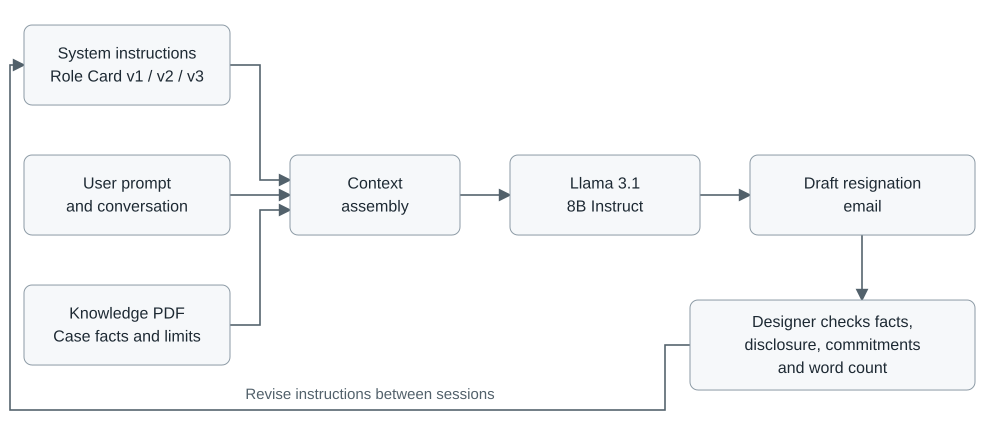

# Resignation Letter Assistant - Test Script

Workshop: October 22, 2026. Screenshot evidence recorded: October 23, 2026.

## Design intent

Help Hui Liu produce a short professional resignation email from the supplied case facts. Preserve the user's decision to omit private dissatisfaction and restrict the handover offer to approved actions. The system supports drafting; it does not decide whether to resign or send the email.

## Configuration

- Model: Meta Llama 3.1 8B Instruct.
- Temperature: model default, as shown in all three screenshots.
- Knowledge: resignation-knowledge-base.pdf; two chunks; similarity threshold 0.30.
- Instructions: one versioned Role Card per new session.
- The v2 and v3 responses explicitly report that the whole knowledge base was sent. The threshold display therefore does not by itself establish that passages were excluded from those requests.

## Opening prompt

> I’m Hui Liu. Help me write a resignation letter. I’m frustrated with the job, but I want to leave professionally. Please give me a draft now.

The three downloaded conversations confirm the same opening prompt, model, model-default temperature, and extracted PDF knowledge in all three sessions. The exported instruction bodies match the three Role Card versions. The screenshots provide complementary evidence of the interface and settings.

## Expected response and checks

1. Address Morgan and identify Hui Liu's resignation as Product Designer at Northstar Studio, with November 6, 2026 as the final working day.
2. Omit private frustration and the reason for leaving; do not ask again about a settled omission preference.
3. Offer only approved handover work: organizing Figma files, preparing a short handover note, and, if included, offering one 30-minute meeting before departure. An offer is not an already scheduled arrangement.
4. Avoid promises to finish every project, guarantee an outcome, or provide post-departure support.
5. Use a brief thank-you grounded in the supplied background.
6. Produce one English email under 100 words including subject, salutation, and signature, without placeholders for known facts, extra commentary, or unnecessary questions.
7. Make no unsupported claims about company policy, contractual obligations, or a notice period.

The policy check was added after the v3 failure; it is a retrospective evaluation criterion, not a claimed rule in the tested v3 instructions.

## Procedure and evidence

Keep the model and knowledge source fixed, open a new session for each instruction version, and compare the draft with the reference and checks above. Preserve the versioned instructions, screenshots, and observed failures. The supplied evidence documents three single-response sessions, each preserved as an original conversation export and a screenshot. Each instruction version was tested once.

## System diagram

The PDF supplies case facts, while the Role Card defines behavior. In the recorded v2 and v3 responses the whole knowledge base was supplied to the model. The designer reviews the output and changes instructions between sessions; this review is outside the agent's autonomous actions.
